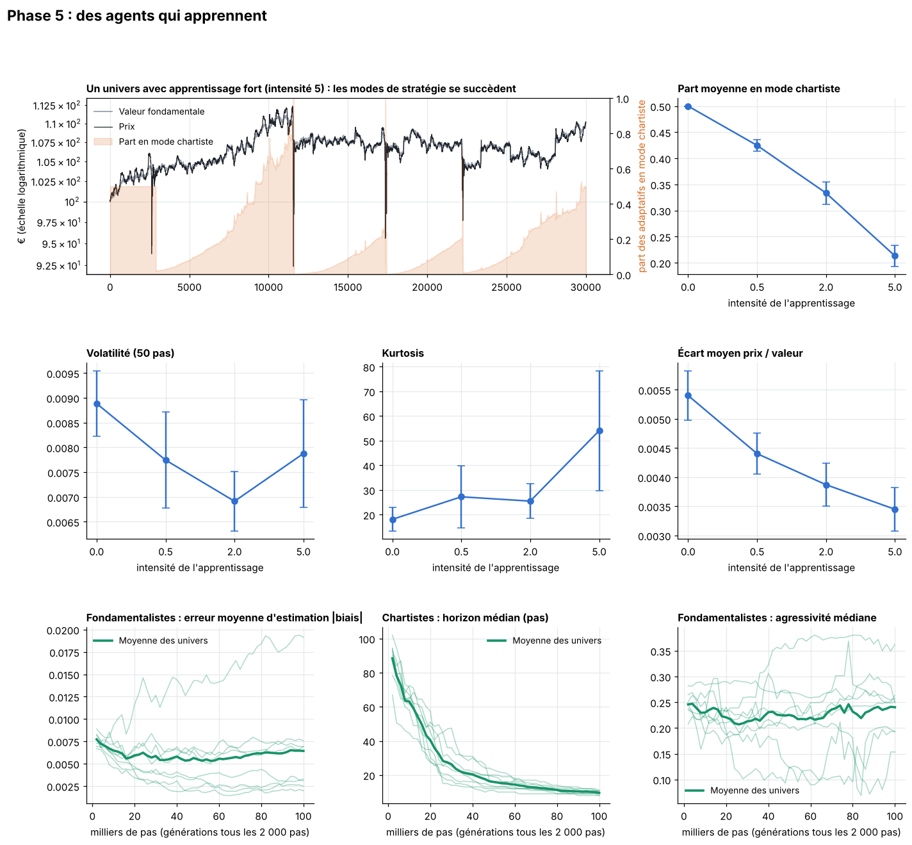

# Phase 5 : des agents qui apprennent

*Généré le 18/11/2026 par `python apprendre.py`.*

## Expérience A : agents adaptatifs (Brock et Hommes 1998)

100 agents adaptatifs remplacent 50 fondamentalistes et 50 chartistes. Avant chaque décision, ils choisissent leur stratégie avec une probabilité logit fondée sur le score récent des deux stratégies (demi-vie de 2 000 pas). 12 univers par intensité, 30 000 pas.

| Intensité | Part en mode chartiste | Volatilité | Kurtosis | Écart prix / valeur | Pire chute | corr(part chartiste, volatilité suivante) |
|---|---|---|---|---|---|---|
| 0.0 | 50% | 0.89% | 18.1 | 0.54% | 17.2% | — |
| 0.5 | 42% | 0.77% | 27.2 | 0.44% | 18.1% | +0.14 |
| 2.0 | 33% | 0.69% | 25.5 | 0.39% | 18.0% | +0.30 |
| 5.0 | 21% | 0.79% | 54.1 | 0.34% | 19.5% | +0.37 |

## Expérience B : évolution des stratégies (8 univers de 100 000 pas, avec et sans évolution)

Tous les 2 000 pas, les 10 % de fondamentalistes et de chartistes les moins performants copient les paramètres d'un des 20 % les meilleurs, avec mutation.

| Indicateur | Début | Fin |
|---|---|---|
| Fondamentalistes : erreur moyenne d'estimation |biais| | 0.77% | 0.64% |
| Fondamentalistes : agressivité médiane | 0.25 | 0.24 |
| Chartistes : horizon médian (pas) | 88 | 10 |
| Chartistes : échelle de tendance médiane | 0.030 | 0.032 |

Efficience du marché par tranche de 10 000 pas (écart moyen prix / valeur) :

| Tranche | Sans évolution | Avec évolution |
|---|---|---|
| 0–10 k | 0.60% | 0.64% |
| 10–20 k | 0.80% | 0.56% |
| 20–30 k | 0.85% | 0.73% |
| 30–40 k | 0.91% | 0.63% |
| 40–50 k | 0.94% | 0.65% |
| 50–60 k | 1.05% | 0.67% |
| 60–70 k | 1.24% | 0.63% |
| 70–80 k | 1.60% | 0.70% |
| 80–90 k | 1.72% | 0.68% |
| 90–100 k | 1.38% | 0.69% |

| Sur toute la durée | Sans évolution | Avec évolution |
|---|---|---|
| Volatilité | 1.16% [1.04% ; 1.28%] | 0.80% [0.71% ; 0.88%] |
| Kurtosis | 21.6 [17.5 ; 25.8] | 27.3 [22.2 ; 32.5] |
| Écart prix / valeur | 1.11% [0.86% ; 1.37%] | 0.66% [0.49% ; 0.83%] |
| Pire chute | 29.0% [22.4% ; 35.7%] | 24.1% [20.1% ; 28.1%] |

