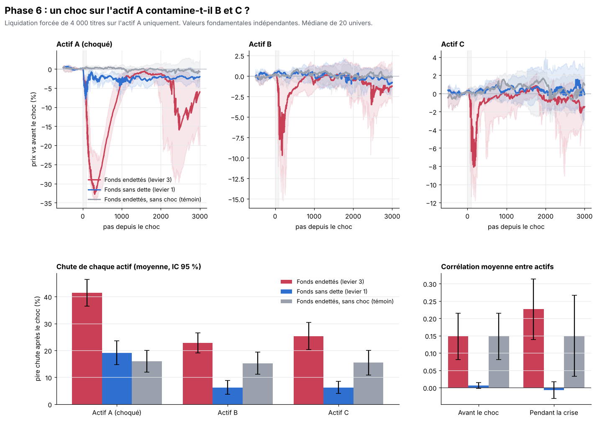

# Phase 6 : contagion systémique

*Généré le 18/11/2026 par `python contagion.py` : 20 univers appariés par scénario.*

Trois actifs, chacun avec son propre marché (402 agents locaux) et une valeur fondamentale **indépendante**. Vingt fonds multi-actifs détiennent chacun 300 titres de chaque actif, sur un compte unique. Au pas 8 000, une liquidation forcée de 4 000 titres frappe **uniquement l'actif A**.

Les deux scénarios ont exactement les mêmes fonds, avec les mêmes positions. Seule la dette diffère :

- **Fonds endettés (levier 3)** : 30 000 € de capital pour 90 000 € de titres, soumis aux appels de marge ;
- **Fonds sans dette (levier 1)** : 90 000 € de capital, donc aucune marge à appeler.

- **Témoin** : les fonds endettés, mais sans aucun choc. Il sépare l'effet du choc de la fragilité de fond due à l'endettement.

| Mesure | Fonds endettés | Fonds sans dette | Témoin sans choc | Effet du choc à dette égale (endettés − témoin) | Effet de la dette à choc égal (endettés − sans dette) |
|---|---|---|---|---|---|
| Pire chute de l'actif A (choqué) | 41.5% | 19.1% | 16.0% | 25.5% [19.2% ; 31.8%] | 22.3% [15.9% ; 28.8%] |
| Pire chute de l'actif B | 22.8% | 6.2% | 15.2% | 7.6% [3.1% ; 12.0%] | 16.6% [12.2% ; 21.0%] |
| Pire chute de l'actif C | 25.3% | 6.3% | 15.4% | 9.9% [4.5% ; 15.2%] | 19.1% [14.9% ; 23.3%] |
| Corrélation entre actifs avant le choc | +0.148 | +0.006 | +0.148 | +0.000 [+0.000 ; +0.000] | +0.142 [+0.077 ; +0.207] |
| Corrélation entre actifs pendant la crise | +0.226 | -0.007 | +0.149 | +0.077 [-0.060 ; +0.214] | +0.233 [+0.141 ; +0.325] |
| Appels de marge avant le choc | 61 | 0 | 61 | 0 [0 ; 0] | 61 [51 ; 70] |
| Appels de marge pendant la crise | 57 | 0 | 27 | 30 [17 ; 43] | 57 [46 ; 67] |

