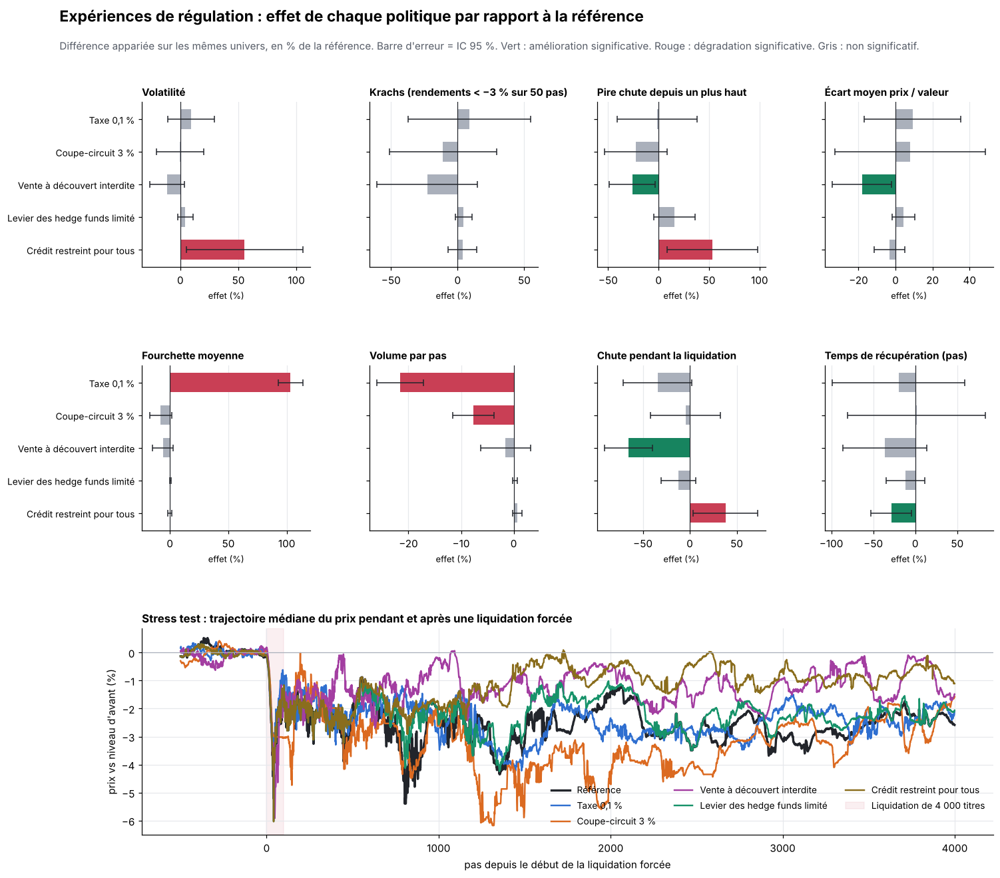

# Expériences de régulation

*Générées le 17/11/2026 par `python experimenter.py` : 6 politiques × 20 univers appariés, 30 000 pas par univers, plus un stress test par univers.*

Chaque politique est simulée sur exactement les mêmes univers que la référence (mêmes graines, donc mêmes news). L'effet est la différence moyenne entre les deux, avec un intervalle de confiance à 95 %. Un effet n'est retenu que si cet intervalle exclut 0.

## Les politiques testées

- **Référence** : aucune régulation
- **Taxe 0,1 %** : chaque partie paie 0,1 % du montant échangé (taxe de type Tobin)
- **Coupe-circuit 3 %** : cotation suspendue 100 pas si le prix bouge de plus de 3 % en 200 pas
- **Vente à découvert interdite** : aucun agent (hors teneurs de marché) ne peut détenir moins de 0 titre
- **Levier des hedge funds limité** : découvert des chartistes (hedge funds) réduit de 10 000 € à 2 000 €
- **Crédit restreint pour tous** : découvert de tous les agents réduit de 10 000 € à 2 000 € (y compris les investisseurs value)

## Marché normal

### Volatilité

| Politique | Valeur | Effet vs référence | IC 95 % | Verdict |
|---|---|---|---|---|
| Référence | 0.94% | — | — | — |
| Taxe 0,1 % | 1.03% | +9.4 % | [-10.8 % ; +29.5 %] | ≈ pas d'effet significatif |
| Coupe-circuit 3 % | 0.94% | -0.2 % | [-20.4 % ; +20.0 %] | ≈ pas d'effet significatif |
| Vente à découvert interdite | 0.83% | -11.5 % | [-26.5 % ; +3.5 %] | ≈ pas d'effet significatif |
| Levier des hedge funds limité | 0.98% | +4.4 % | [-2.3 % ; +11.2 %] | ≈ pas d'effet significatif |
| Crédit restreint pour tous | 1.46% | +55.4 % | [+5.1 % ; +105.6 %] | ❌ pire |

### Krachs (rendements < −3 % sur 50 pas)

| Politique | Valeur | Effet vs référence | IC 95 % | Verdict |
|---|---|---|---|---|
| Référence | 6.8 | — | — | — |
| Taxe 0,1 % | 7.4 | +8.8 % | [-37.0 % ; +54.6 %] | ≈ pas d'effet significatif |
| Coupe-circuit 3 % | 6.0 | -11.0 % | [-51.2 % ; +29.2 %] | ≈ pas d'effet significatif |
| Vente à découvert interdite | 5.2 | -22.8 % | [-60.4 % ; +14.8 %] | ≈ pas d'effet significatif |
| Levier des hedge funds limité | 7.1 | +4.4 % | [-1.9 % ; +10.7 %] | ≈ pas d'effet significatif |
| Crédit restreint pour tous | 7.0 | +3.7 % | [-7.2 % ; +14.5 %] | ≈ pas d'effet significatif |

### Pire chute depuis un plus haut

| Politique | Valeur | Effet vs référence | IC 95 % | Verdict |
|---|---|---|---|---|
| Référence | 24.4% | — | — | — |
| Taxe 0,1 % | 24.1% | -1.3 % | [-40.9 % ; +38.3 %] | ≈ pas d'effet significatif |
| Coupe-circuit 3 % | 18.9% | -22.4 % | [-53.3 % ; +8.5 %] | ≈ pas d'effet significatif |
| Vente à découvert interdite | 18.0% | -26.1 % | [-49.0 % ; -3.3 %] | ✅ mieux |
| Levier des hedge funds limité | 28.2% | +15.6 % | [-4.9 % ; +36.0 %] | ≈ pas d'effet significatif |
| Crédit restreint pour tous | 37.5% | +53.4 % | [+8.3 % ; +98.5 %] | ❌ pire |

### Écart moyen prix / valeur

| Politique | Valeur | Effet vs référence | IC 95 % | Verdict |
|---|---|---|---|---|
| Référence | 0.73% | — | — | — |
| Taxe 0,1 % | 0.79% | +9.2 % | [-16.9 % ; +35.3 %] | ≈ pas d'effet significatif |
| Coupe-circuit 3 % | 0.79% | +8.0 % | [-32.7 % ; +48.6 %] | ≈ pas d'effet significatif |
| Vente à découvert interdite | 0.60% | -18.2 % | [-34.2 % ; -2.2 %] | ✅ mieux |
| Levier des hedge funds limité | 0.76% | +4.3 % | [-1.7 % ; +10.4 %] | ≈ pas d'effet significatif |
| Crédit restreint pour tous | 0.70% | -3.2 % | [-11.5 % ; +5.1 %] | ≈ pas d'effet significatif |

### Fourchette moyenne

| Politique | Valeur | Effet vs référence | IC 95 % | Verdict |
|---|---|---|---|---|
| Référence | 0.105 € | — | — | — |
| Taxe 0,1 % | 0.214 € | +103.3 % | [+92.8 % ; +113.8 %] | ❌ pire |
| Coupe-circuit 3 % | 0.097 € | -7.9 % | [-17.4 % ; +1.5 %] | ≈ pas d'effet significatif |
| Vente à découvert interdite | 0.099 € | -6.1 % | [-14.9 % ; +2.8 %] | ≈ pas d'effet significatif |
| Levier des hedge funds limité | 0.106 € | +0.4 % | [-0.3 % ; +1.1 %] | ≈ pas d'effet significatif |
| Crédit restreint pour tous | 0.105 € | -0.2 % | [-2.0 % ; +1.5 %] | ≈ pas d'effet significatif |

### Volume par pas

| Politique | Valeur | Effet vs référence | IC 95 % | Verdict |
|---|---|---|---|---|
| Référence | 15.0 | — | — | — |
| Taxe 0,1 % | 11.8 | -21.6 % | [-25.9 % ; -17.2 %] | ❌ pire |
| Coupe-circuit 3 % | 13.9 | -7.7 % | [-11.6 % ; -3.7 %] | ❌ pire |
| Vente à découvert interdite | 14.8 | -1.6 % | [-6.3 % ; +3.2 %] | ≈ pas d'effet significatif |
| Levier des hedge funds limité | 15.0 | +0.2 % | [-0.2 % ; +0.7 %] | ≈ pas d'effet significatif |
| Crédit restreint pour tous | 15.1 | +0.7 % | [-0.1 % ; +1.5 %] | ≈ pas d'effet significatif |

## Stress test : liquidation forcée de 4 000 titres au pas 12 000

### Chute pendant la liquidation

| Politique | Valeur | Effet vs référence | IC 95 % | Verdict |
|---|---|---|---|---|
| Référence | 36.8% | — | — | — |
| Taxe 0,1 % | 24.1% | -34.4 % | [-70.9 % ; +2.1 %] | ≈ pas d'effet significatif |
| Coupe-circuit 3 % | 35.1% | -4.5 % | [-41.7 % ; +32.6 %] | ≈ pas d'effet significatif |
| Vente à découvert interdite | 12.9% | -65.0 % | [-90.6 % ; -39.4 %] | ✅ mieux |
| Levier des hedge funds limité | 32.3% | -12.4 % | [-30.8 % ; +6.1 %] | ≈ pas d'effet significatif |
| Crédit restreint pour tous | 50.8% | +38.0 % | [+3.4 % ; +72.7 %] | ❌ pire |

### Temps de récupération (pas)

| Politique | Valeur | Effet vs référence | IC 95 % | Verdict |
|---|---|---|---|---|
| Référence | 1282 | — | — | — |
| Taxe 0,1 % | 1099 | -19.8 % | [-98.8 % ; +59.1 %] | ≈ pas d'effet significatif |
| Coupe-circuit 3 % | 1268 | +1.5 % | [-80.7 % ; +83.8 %] | ≈ pas d'effet significatif |
| Vente à découvert interdite | 885 | -35.9 % | [-85.9 % ; +14.1 %] | ≈ pas d'effet significatif |
| Levier des hedge funds limité | 1131 | -11.7 % | [-34.7 % ; +11.2 %] | ≈ pas d'effet significatif |
| Crédit restreint pour tous | 916 | -28.5 % | [-52.6 % ; -4.4 %] | ✅ mieux |

