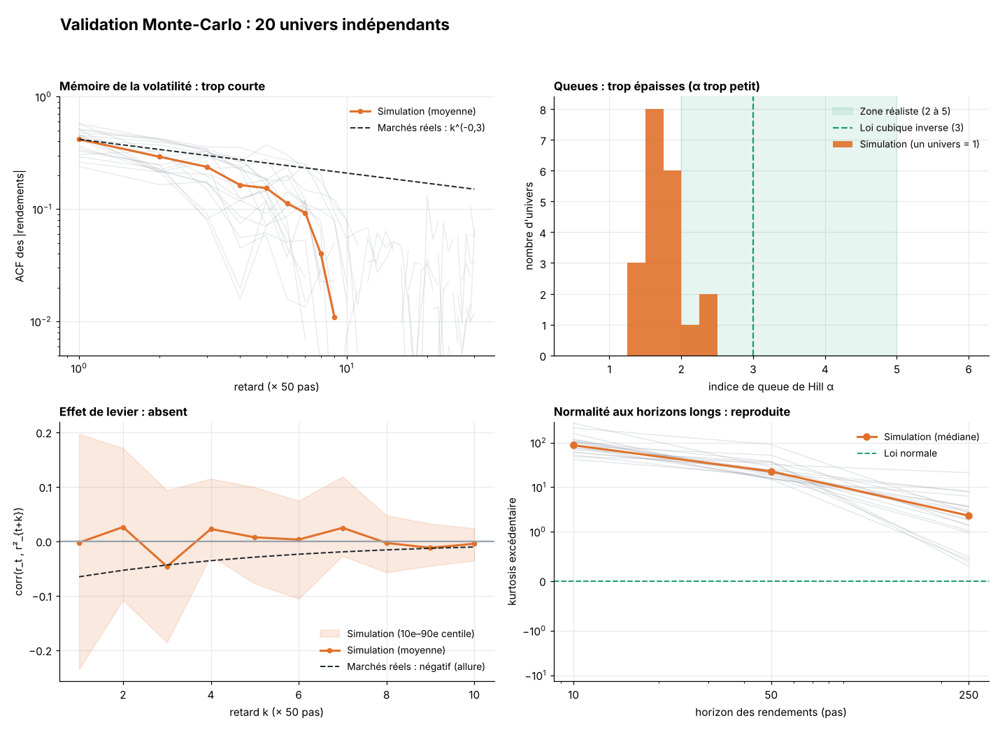

# Validation Monte-Carlo du simulateur

*Générée le 17/11/2026 par `python valider.py` : 20 univers indépendants de 30 000 pas, rendements sur 50 pas.*

Chaque univers a sa propre graine aléatoire. Pour chaque fait stylisé, on donne la part d'univers qui le reproduisent, la moyenne et son intervalle de confiance à 95 %.

| Fait stylisé | Univers OK | Moyenne | IC 95 % | Marchés réels |
|---|---|---|---|---|
| ✅ Queues épaisses | 20/20 | 28.3 | [20.6 ; 36.1] | kurtosis excédentaire nettement > 0 |
| ❌ Indice de queue (Hill) | 3/20 | 1.76 | [1.64 ; 1.89] | ≈ 3, entre 2 et 5 (loi cubique inverse) |
| ✅ Queues épaisses émergentes | 16/20 | 33.2 | [22.2 ; 44.3] | (test propre au modèle) persistent sans news |
| ✅ Rendements imprévisibles | 18/20 | 0.098 | [0.091 ; 0.105] | |ACF| des rendements ≈ 0 au-delà de quelques minutes |
| ✅ Volatilité en grappes | 20/20 | 0.152 | [0.123 ; 0.180] | ACF des |rendements| > 0 |
| ❌ Mémoire longue de la volatilité | 2/20 | 1.00 | [0.88 ; 1.11] | décroissance en k^(-β), β ≈ 0,2 à 0,4 |
| ✅ Normalité aux horizons longs | 20/20 | 3.7 | [1.6 ; 5.7] | la kurtosis baisse quand l'horizon s'allonge |
| ❌ Effet de levier | 5/20 | +0.001 | [-0.013 ; +0.015] | corr(rendement, volatilité future) < 0 |
| ❌ Asymétrie gains / pertes | 5/20 | +0.21 | [-0.55 ; +0.97] | skewness < 0 (krachs plus violents que les envolées) |
| ✅ Volume ↔ volatilité | 20/20 | 0.63 | [0.60 ; 0.65] | corrélation positive |
| ✅ Ancrage sur la valeur | 20/20 | 0.37% | [0.34% ; 0.40%] | (test propre au modèle) écart moyen < 5 % |

Pour « Queues épaisses émergentes », la valeur est la kurtosis du prix dans l'expérience témoin sans news. Pour « Normalité aux horizons longs », c'est la kurtosis sur 250 pas.

Références : Cont (2001), *Quantitative Finance* 1(2) ; Gopikrishnan et al. (1999), *Phys. Rev. E* 60 ; Bouchaud, Matacz & Potters (2001), *Phys. Rev. Lett.* 87.
